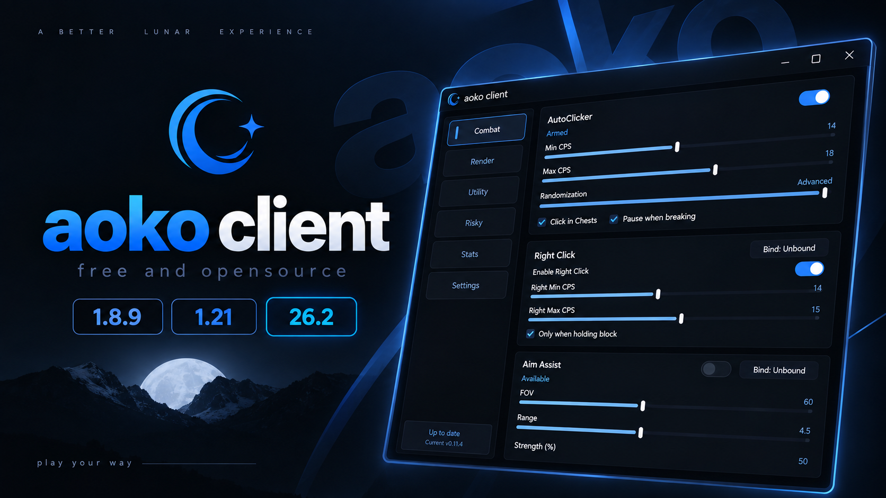
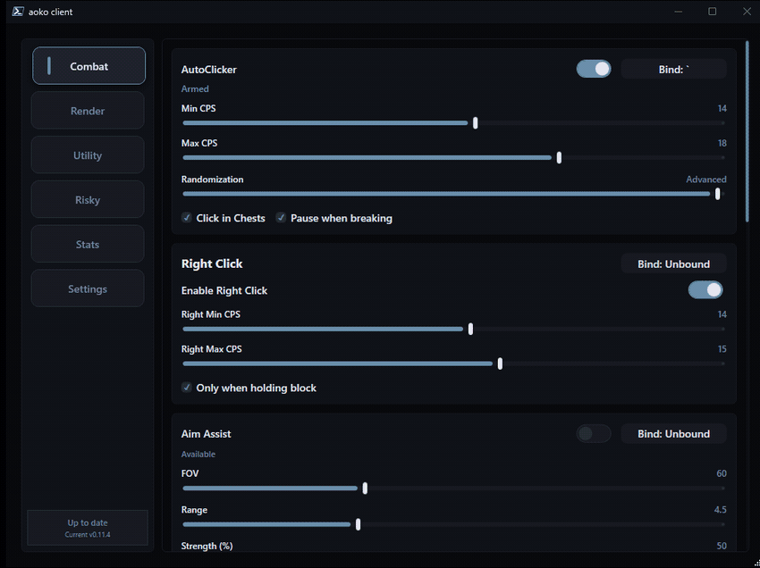
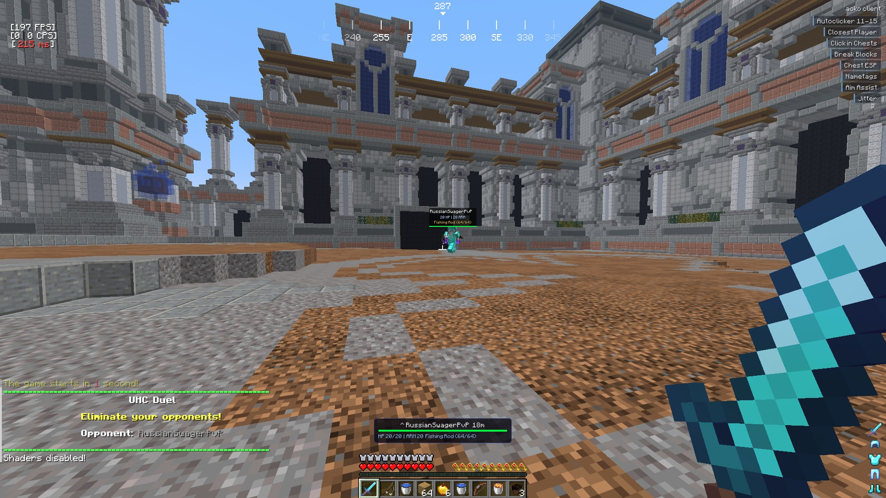

# aoko client

**English** | [简体中文](README.zh-CN.md)

[](https://github.com/naczo5/aoko-client/releases/latest)
[](https://github.com/naczo5/aoko-client/releases)
[](https://github.com/naczo5/aoko-client/stargazers)
[](https://github.com/naczo5/aoko-client/blob/main/LICENSE)

aoko client 是一个开源的 Windows 辅助客户端（utility client），为 Lunar Client 以及 Forge/Fabric 的 Minecraft 实例提供外部覆盖层。

# 展示
[](https://www.youtube.com/watch?v=eR7QKAWw8D4)

## 当前状态

- 支持版本：**26.2**、**26.1**、**1.21.x** 与 **1.8.9**。
- 支持环境：**Lunar Client**，以及**独立的 Minecraft 实例**（1.8.9 使用 Forge，现代版本使用 Fabric）。
- 在 **现代 26.2** 上，游戏可以通过 OpenGL 或新的 **Vulkan** 渲染器输出画面；`bridge_261.dll` 会在运行时自动检测 OpenGL/Vulkan，并在两者之上原生渲染覆盖层（关闭开关：设置 `AOKO_BRIDGE261_VULKAN=0` 可强制禁用 Vulkan 路径）。
- 外部 GUI 默认使用硬件渲染；设置 `AOKO_SOFTWARE_RENDERING=1` 可强制软件渲染（适用于显卡驱动异常或 RDP 截屏问题）。

## 功能（当前）

- Kill Aura（可配置 CPS、攻击/挥动距离、FOV、自动格挡、平滑转向）
- Autoclicker（左/右键、CPS 区间、抖动、仅对方块生效等选项）
- Aim Assist（瞄准辅助）
- Triggerbot
- SpeedBridge（速桥）
- Reach 与 Velocity 控制
- AutoTotem（仅背包模式与无政府模式）
- Auto Rod（自动/强制切换快捷栏、单次使用动作绑定、精确还原原槽位）
- Throwpot（动作绑定时立即投掷快捷栏中第一瓶治疗喷溅药水并还原槽位）
- AutoHeal（生命值低于可配置阈值时自动投掷治疗喷溅药水）
- AutoTool（指向方块时自动切换武器、选择最优工具、起床战争模式）
- AntiDebuff（客户端隐藏失明/反胃，1.21/26.1/26.2 上还包括黑暗效果）
- Nick Hider（基于 JVMTI 的本地名称伪装）
- Hit Delay Fix（移除 1.8.9 的攻击冷却延迟）
- Chest Stealer（基于外部光标操作箱内物品，带菜单检查）
- Refill（背包打开时用 shift 点击把瞬间治疗/再生药水与金苹果补进空的快捷栏槽位）
- GTB Helper 与 Pixel Party Assist
- Discord Rich Presence
- Nametags、Closest Player 面板、Fight Status、Chest ESP、Block ESP、BedPlates、Fireball Warning
- 游戏内 HUD 编辑器与模块列表样式
- 每个模块独立的按键绑定（默认均未绑定，可在 WPF 与 ClickGUI 中配置）
- 配置文件保存在 `%AppData%\Aoko\profiles\`
- GUI 自定义（slate 调色板、模块列表样式、是否显示 logo）

## 截图




## 环境要求

- Windows 10/11 x64
- Lunar Client
- .NET 8 SDK（仅构建需要）
- MinGW-w64 + JDK 17 头文件（仅构建原生部分需要）

## 快速开始

1. 启动 Lunar Client。
2. 运行 `Aoko.exe`。
3. 点击 **Inject**。
4. 使用外部 GUI。

_请在已进入服务器或存档后注入，模块才能干净地初始化。_

## 使用 Scoop 安装与更新

Aoko 通过本仓库的 Scoop bucket 分发。安装 [Scoop](https://scoop.sh/) 后，添加 bucket 并安装：

```powershell
scoop bucket add aoko https://github.com/naczo5/aoko-client
scoop install aoko
```

更新前请先关闭 Aoko，然后运行：

```powershell
scoop update aoko
```

卸载请运行 `scoop uninstall aoko`。Scoop 只更新程序文件；你的配置与自定义调色板仍保留在 `%AppData%\Aoko`。

## 构建

除特别说明外，请在仓库根目录执行。

### 原生桥接 DLL

- 构建全部：`build_dll.bat`
- 仅构建 26.1：`McInjector\build_261.bat`
- 仅构建 1.8.9：`McInjector\build.bat`

### 加载器（C#）

- Debug 构建：`dotnet build Aoko\Aoko.csproj`
- Release 构建：`dotnet build -c Release Aoko\Aoko.csproj`
- 运行：`dotnet run --project Aoko\Aoko.csproj`
- 发布 release 可执行文件：`build_exe.bat`

### 完整发布流程

- `build_release.bat`

## 测试

- 运行 C# 测试：`dotnet test Aoko.Tests\Aoko.Tests.csproj`
- 运行原生测试套件：`McInjector\run_tests.bat`

## 版本说明

- `bridge_261.dll` 是用于 26.1 与 1.21 注入的现代桥接 DLL。
- `bridge.dll` 用于 1.8.9 注入，有时被称为 legacy。

## 项目结构

```text
aoko/
|- Aoko/              # WPF 加载器 + 外部 GUI（.NET 8）
|  |- Core/                    # 连点器、钩子、配置、TCP 客户端
|  |- MainWindow.xaml(.cs)     # 主界面
|  |- bridge.dll               # 1.8.9 桥接（legacy）
|  `- bridge_261.dll           # 26.1 桥接
|- McInjector/
|  |- build.bat                # 1.8.9 桥接构建（legacy）
|  |- build_261.bat            # 26.1 桥接构建
|  `- src/main/cpp/            # 原生桥接源码
|- website/                    # 文档站（Astro + Starlight）+ public/ 中的落地页
`- README.md
```

## 架构

- C# 加载器把桥接 DLL 注入 Lunar，并负责设置与界面。
- 桥接与加载器通过 TCP（`25590`）通信。
- 桥接通过 OpenGL/Vulkan 上的即时模式 UI 渲染覆盖层，并通过 JNI 读取游戏状态。
- 输入动作通常通过 Win32 `SendInput` 发送。
- 桥接能力（capabilities）用于按版本启用或限制模块与选项。

## 贡献

欢迎针对问题修复与新模块提交 PR。

- 在 Issues 中报告问题时，请附上客户端目录中的日志文件。
- 新模块应在主流服务器/测试服务器上验证。
- 请注明新模块是否绕过反作弊，或仅适用于私人/无政府服务器。

## 支持

ETH - `0x04166c3bec4e2e28799AdFa0b336b0159d90c699`
